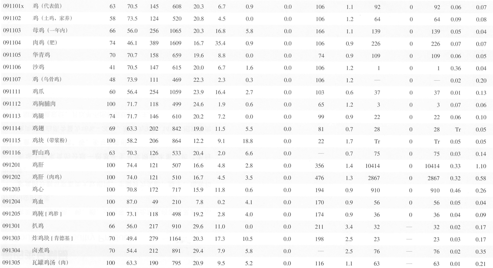
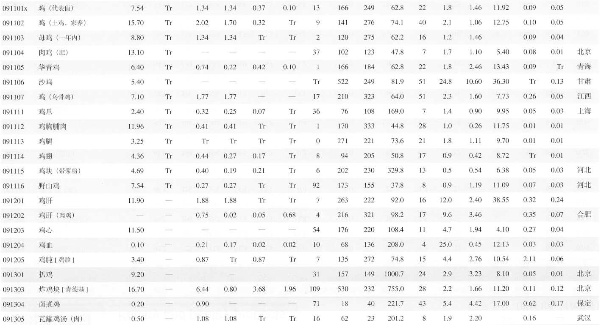
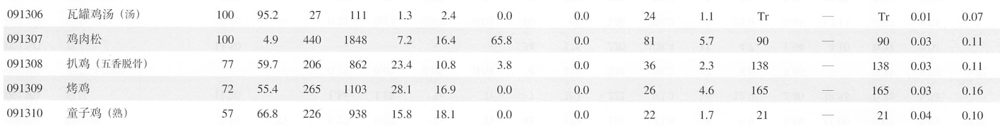
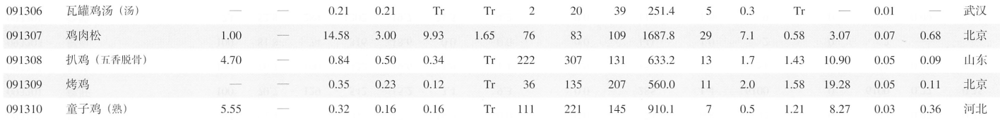
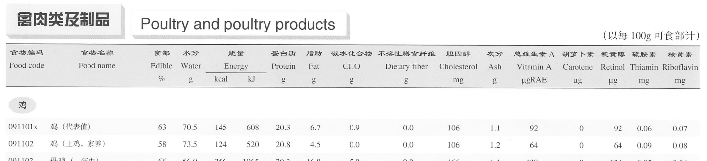
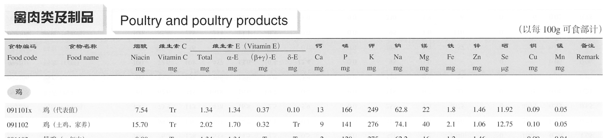

# 说明

此处的测试数据，主要为了[Sanotsu/free-fitness](https://github.com/Sanotsu/free-fitness) 项目的食物导入功能的测试。

将 pdf 版本的[《中国食物成分表标准版（第 6 版）》](https://www.pumpedu.com/home-shop/5514.html) 中"能量和食物一般营养成分"部分进行截图，通过 python 脚本构建为指定格式的 json 文件。

---

2026-09-08 更新（食物中英文名）

新增 [食物名称中英文对照表截图](./食物名称中英文对照表截图) 的识别流水线（`index_v3_en.py`，详见 [V3 对照表方案说明](docs/README_V3_EN.md)），并生成两类数据：

- **增强版营养数据（推荐使用）**：[json_data_v3_20260825_qwen38max_kimi_k3_fixed_en](./json_data_v3_20260825_qwen38max_kimi_k3_fixed_en)

  - 在手动矫正版（fixed）基础上按 `foodCode` 回填 `englishName`（紧跟 `foodName` 字段），1677 条中 **1242 条（74.1%）** 有英文名
  - 其余字段与 fixed 版逐字节等价；`enrich_log.json` 记录回填明细
  - **表格形态：同目录下 `food_composition_full.csv`（全量单文件）与
    `food_composition_full.xlsx`（Sheet「全部数据」+ 每类别一个 Sheet，共 62 个）**
    - 由 `utils_v3/export_tabular.py` 生成，所有单元格按文本写入（`"2.50"`/`Tr`/`—`/`091101x` 等原样保真）

- 中英文对照表识别版：[json_name_en_map_v3_20260906_qwen38max_kimi_k3](./json_name_en_map_v3_20260906_qwen38max_kimi_k3)
  - 60 个类别文件，**1260 条**，每条仅 `foodCode` / `foodName` / `englishName` 三个字段
  - 由 `kimi-k2.7-code` 与 `qwen3.8-max-0902` 双模型交叉识别 + 本地校验 + 人工定点复核
  - 人工仅矫正英文栏位（18 条更新，见 `apply_log.json`；corrections 中留空的 update 一律跳过，不会误清中文名）
  - apply 后重校验 error=0 / warning=0

注意：**原书营养素表与书末中英文对照表本就不是一一对应**（部分营养素条目原书就没有英文名），
foodCode 集合差异（对照表独有 18 条 / 营养素有而对照表无 435 条）属预期现象，不是识别缺漏；
明细见增强版的 `enrich_log.json`（`missing_en` / `en_only_unused`）。

---

2026-08-25 更新

**营养数据**在以下文件夹（含英文名的增强版见下方 2026-09-08 更新）：

- 原书识别版：[json_data_v3_20260825_qwen38max_kimi_k3](./json_data_v3_20260825_qwen38max_kimi_k3)
- 手动矫正版：[json_data_v3_20260825_qwen38max_kimi_k3_fixed](./json_data_v3_20260825_qwen38max_kimi_k3_fixed)

识别说明：

- 食品数据共计 **1677 条**，61 个类别文件，可直接使用
- 先由两个视觉大模型（`qwen3.8-max` 与 `kimi-k3`）交叉识别
- 再本地自动校验（恒等式/值域/行数/双模型共识）
- 然后经人工定点复核修正生成(我只处理了两个模型识别不一致的地方)
  - **目前可能数据出错就是 qwen3.8-max 和 kimi-k3 的视觉识别都错了，还错成一样了**
- `apply_log.json` 记录人工修正与重校验结果
- 约 11.4 万个单元格的处理链路已经 `utils_v3/test_v3_output.py` 独立重放验证零偏差

校对说明：

- 原书中 `蔬菜类及其制品-野生蔬菜类`（048004~048084），能量 kcal 和 kJ 数值明显是标反了的
- 这部分可以确认的，手动调整为正确的值（而识别版优先数据和原书一致，错也错一样）

"婴幼儿食品"分类的表格栏位与其他分类不同，且数据多为品牌奶粉商品而非通用数据，流水线通过配置 `ignore_prefixes` 跳过，数据中不包含该分类。

我的两个基准大模型 API 构建的原始 json 数据，可查看 [https://cfcd.pages.dev/](https://cfcd.pages.dev/)

---

2025-07-24 添加了 [食物升糖指数（GI）截图](./食物升糖指数（GI）截图) 和 [食物 GI 指数 json 文件](json_gi_of_foods/glycemic_index_of_foods.json) (这个数据量少，有手动检查过)。

---

## 脚本说明

将同类食物"能量"部分和"一般营养成分"部分的成对截图，  
调用两个视觉大模型 API 识别为 JSON 结构化数据（字段显式命名、数值原文保真），  
按 foodCode 配对合并、双模型交叉校验，  
再经人工复核修正，构建成指定格式的 json 文件。

即多张同类食物"能量"部分和"一般营养成分"部分的截图，如：

`禽肉类及其制品-鸡1-energy.png`:


`禽肉类及其制品-鸡1-nutrient.png`:


`禽肉类及其制品-鸡2-energy.png`:


`禽肉类及其制品-鸡2-nutrient.png`:


转换为单个`merged_禽肉类及其制品-鸡.json`文件

```json
[
  {
    "foodCode": "091101x",
    "foodName": "鸡（代表值）",
    "edible": "63",
    "water": "70.5",
    "energyKCal": "145",
    "energyKJ": "608",
    "protein": "20.3",
    "fat": "6.7",
    "CHO": "0.9",
    "dietaryFiber": "0.0",
    "cholesterol": "106",
    "ash": "1.1",
    "vitaminA": "92",
    "carotene": "0",
    "retinol": "92",
    "thiamin": "0.06",
    "riboflavin": "0.07",
    "niacin": "7.54",
    "vitaminC": "Tr",
    "vitaminETotal": "1.34",
    "vitaminE1": "1.34",
    "vitaminE2": "0.37",
    "vitaminE3": "0.10",
    "Ca": "13",
    "P": "166",
    "K": "249",
    "Na": "62.8",
    "Mg": "22",
    "Fe": "1.8",
    "Zn": "1.46",
    "Se": "11.92",
    "Cu": "0.09",
    "Mn": "0.05",
    "remark": ""
  },
    ……
]
```

## 各个栏位中文名称

energy 部分栏位中文名称:



nutrient 部分栏位中文名称:



## 运行

```sh
pip install -r requirements.txt   # openai / aiofiles / python-dotenv

# 1. 在 .env 配置两个视觉大模型的 API 密钥（参考 .env.example）
# 2. 按需调整 config_v3.json（模型清单、试点范围等）
# 3. 跑流水线（识别 + 解析合并 + 校验 + 复核报告）
python index_v3.py --stage all
# 4. 浏览器打开 review_v3/index.html 人工核对
# 5. 需要修正时：
cp review_v3/corrections_template.json review_v3/corrections.json
#    编辑 corrections.json（action: update/delete/insert）
python index_v3.py --stage apply

# 验证处理链路（可选，零 API 调用）
python utils_v3/test_v3_output.py

# 生成矫正版（可选）：修复原书能量 kcal/kJ 整列互换（野生蔬菜类 68 条）
python utils_v3/fix_energy_swap.py            # dry-run：仅报告
python utils_v3/fix_energy_swap.py --apply    # 生成/重建 {output_dir}_fixed/
```

中英文对照表流水线（独立配置 `config_v3_en.json`，互不影响营养素流水线）：

```sh
# 1. .env 同样配置 V3_DASHSCOPE_API_BASE / V3_DASHSCOPE_API_KEY
# 2. 识别 + 解析合并 + 校验 + 复核报告（config 中 pilot.dirs 控制试点范围）
python index_v3_en.py --stage all
# 3. 浏览器打开 review_v3_en/index.html 人工核对（只需矫正 englishName；
#    corrections.json 里留空的 update 会被自动跳过，不会误清中文名）
# 4. 应用人工修正并输出最终 JSON
python index_v3_en.py --stage apply

# 生成增强版营养数据（可选）：在 fixed 版基础上按 foodCode 回填英文名
python utils_v3/enrich_nutrition_en.py            # dry-run：仅报告
python utils_v3/enrich_nutrition_en.py --apply    # 生成 {fixed}_en/ 增强版

# 导出表格版（可选）：增强版 → 单CSV + 单XLSX（全量Sheet+每类别Sheet）
python utils_v3/export_tabular.py
```

也可以直接使用 `json_data_v3_20260825_qwen38max_kimi_k3`（1:1 识别版，与原书一致）、
`json_data_v3_20260825_qwen38max_kimi_k3_fixed`（能量矫正版）
或 `json_data_v3_20260825_qwen38max_kimi_k3_fixed_en`（增强版，含英文名）文件夹中的 json 文件。

具体使用方法参看[V3 版本方案说明](docs/README_V3.md)。

## 注意事项

### 数据可能存在逻辑问题，但是这可能就是原书籍就是这样

- **比如原书中 `蔬菜类及其制品-野生蔬菜类`（048004~048084），能量 kcal 和 kJ 数值明显是标反了的**
  - 为了保持和书籍一致，识别版 `json_data_v3_20260825_qwen38max_kimi_k3` 未修正，请严肃注意
  - 矫正版 `json_data_v3_20260825_qwen38max_kimi_k3_fixed` 已将两列交换
    - 68 条，`utils_v3/fix_energy_swap.py` 生成，明细见其中的 `energy_swap_fix_log.json`
- 比如 062101x 桃（代表值）kcal=42/kJ=212、066201x 西瓜（代表值）kcal=31/kJ=108
  - 经核对原书确实如此（比值不满足 4.184 换算），未做修改，使用时注意
- 比如 `畜肉类及其制品-牛 · 082115 牛肉（胸部肉）［牛胸］`
  - 水分 + 蛋白质 + 脂肪 + 碳水 + 灰分 =58.8+16.6+28.8+0.8= 105.0 ，远超 100
  - 这个显得不合理，而且这样的数据非常多
- 目前我将 `config_v3.json` 中的 `thresholds` 配置得极大，忽略了这些内容
- 同样的还有微量元素的值，也在`support_v3/validation.py` 的 `RANGES` 中配置得很宽
  - 实际数据需要专业人员判断，这里优先保证识别的结果和书上原文一致

### 不保证数据识别的绝对一致

- 虽然经过双模型交叉 + 自动校验 + 人工复核后，可疑单元格均已定点核对过；
- 目前可能数据出错就是 qwen3.8-max 和 kimi-k3 的视觉识别都错了，还错得一样
- 若有余力可自行逐行校对，或者使用其他模型测试
  - 个人花了不少费用进行测试，**仅针对当前这个项目的需求**，对应的视觉大模型的识别效果:
  - kimi-k3 > qwen3.8-max > kimi-k2.7-code > [minimax-m3, qwen3.8-2.4t-a95b, qwen3.8-27b, qwen3.7-max-2026-06-08]
    - 后面那几个效果都比较差

### 迭代记录

- 2023-12-30 飞桨 OCR 路线（第一版）
- 2025-07-23 单视觉大模型 markdown 表格转录（第二版）
- 2025-12-06 更新了视觉大模型处理结果，移除了结构不一致的 婴幼儿食品部分，手动添加了 GI 数据
- 2026-08-25 双模型交叉 + 自动校验 + 人工复核验证（第三版）
- 2026-09-08 中英文对照表双模型识别 + 增强版营养数据回填英文名

### 版权声明

所有版权都归原作者所有，脚本仅用于个人学习研究，有任何必要的话请通知我删除此仓库。
