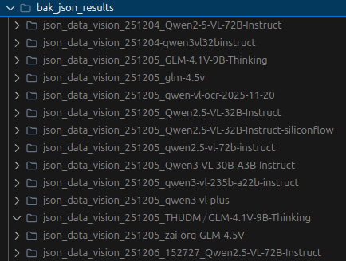

# V3版本方案说明

流水线详细说明（双模型交叉识别 + 自动校验 + 定点人工复核）

## 设计思路

```
图片 → [阶段1 识别] 双模型各识别一遍(JSON结构化输出) → [阶段2 解析合并] energy/nutrient按foodCode合并
    → [阶段3 自动校验] 恒等式/值域/行数/双模型共识 → [阶段4 web复核报告]
    → 人工填写 corrections.json → [阶段5 回写] 应用修正+重校验 → 最终JSON
```

核心思想：不追求一次识别完美，而是用零API成本的机器校验筛出可疑单元格，人工只核对报告中红色标出的极少数位置。

### 为什么用 JSON 而不是 TSV/Markdown

2026 年主流多模态模型（qwen3.8-max、kimi-k3 等）均具备 1M 上下文、64K~1M 输出上限，并官方支持视觉输入 + 结构化输出`response_format`），表格转录的输出体量（单图 <10K token）远低于上限。直接要求模型输出 JSON：

- 每个字段显式命名——TSV 时代的表头缺失/行尾空格丢弃/幻影空列/中部丢列错位等问题从根上消失
- 数值 token 原文保真（解析用 `parse_float=str`，"2.50" 不会变成 "2.5"）
- 解析层零启发式：直接 `json.loads` + 字段完整性校验

### 设计背景

早期尝试过飞桨 OCR 与单模型 markdown 表格转录两条路线，问题都较多（表头缺失、列错位、静默丢行、错误无感知）。本流水线针对性改进：

| 问题     | 旧路线                         | 现做法                                         |
| -------- | ------------------------------ | ---------------------------------------------- |
| 输出格式 | markdown 表                    | JSON 结构化输出（response_format json_object） |
| 响应截断 | 不检查 finish_reason，静默丢行 | 检查 length 即报错重试                         |
| 字段错位 | 按位置盲猜列                   | 字段显式命名，缺失/多余字段自动校验            |
| 配对合并 | foodCode集合并集静默容忍单边   | 单边记录标 error 进复核                        |
| 数值对错 | 无任何校验                     | 恒等式+值域+行数+人工统计核对                  |
| 模型错误 | 无感知                         | 双模型逐字段共识比对，分歧进复核               |

旧路线测试过的视觉模型对比（已被双模型交叉验证取代）：



### 全量实测成绩（2026-08-25，254 张图 / 127 图片对 / 1677 条）

| 指标                    | 结果                                               |
| ----------------------- | -------------------------------------------------- |
| JSON 解析问题           | **0**（TSV 时代同规模约 30-60 条）                 |
| 行数校验（vs 人工统计） | 全对                                               |
| 识别 error              | **0**                                              |
| 需人工裁决 review       | 24 条（名称分歧 9 / 空白vs横线 7 / 矿物错位 9）    |
| 双模型完全一致图片对    | 112/127（88%）                                     |
| 最终重校验              | error=0，warning=20（原书极端值/干物质，数据特性） |

## v3_config.json 配置详解

完整配置示例（带注释版可直接对照 `v3_config.json` 修改）：

```jsonc
{
  // ===== 输入 =====
  "input_dir": "营养素截图", // 图片根目录，脚本递归扫描子目录
  "manual_counts_md": "手动统计图片数据数量251204.md", // 人工逐图统计的行数md（早期版本遗留的人工基准），
  //   用于阶段3行数校验——唯一能检出"双模型同时漏行/多行"的规则；
  //   不想用可指向不存在的文件（该检查自动跳过）
  "ignore_prefixes": ["婴幼儿食品"], // 跳过文件名/目录包含这些前缀的图片（该分类表格栏位不同，无法处理）

  // ===== 输出 =====
  "temp_dir": "temp_v3", // 中间产物目录（raw/parsed/consensus/validation 都在其下）
  "review_dir": "review_v3", // 复核web项目目录：固定独立（不随 temp_dir 变化），
  //   每次执行流水线自动覆盖更新数据，浏览器固定打开这里
  "output_dir": "json_data_v3", // 阶段5最终JSON目录；固定目录 = 每次apply都更新同一份（推荐，
  //   过时类别文件自动清理）；null = 按日期+模型自动生成 "json_data_v3_{日期}_{模型A}+{模型B}"
  //   （每次生成为新目录，适合留存多套识别结果的场景；换模型组合复用固定目录时注意会相互覆盖）

  // ===== 模型清单（核心配置）=====
  "models": [
    {
      "tag": "qwen38max", // 模型短名，用作 raw/parsed 子目录名和报告显示（自定义，英文数字）
      "model_name": "qwen3.8-max", // API 的模型ID（平台模型名，一字不差）
      "api_base_env": "V3_DASHSCOPE_API_BASE", // .env 中环境变量名（引用而非明文，避免密钥入库）
      "api_key_env": "V3_DASHSCOPE_API_KEY",
      "max_tokens": 16384, // 单图最大输出token；JSON比TSV多约50%字段名开销，
      //   qwen3.8-max上限64K、kimi-k3默认131072，16384余量充足
      "temperature": 0.1, // 采样温度；不支持该参数的模型必须设为 null（不发送），如 kimi-k3
      "timeout": 300, // 单次请求整体超时（秒）
      "response_format": { "type": "json_object" }, // 结构化输出；个别平台不支持时删除该行
      //   （解析层有代码块剥离/花括号截取兜底）
      "extra_payload": {
        // 附加请求参数（原样并入请求体）
        "enable_thinking": false, //   关闭思考模式；不同平台参数名不同，见下文"关闭思考模式速查"
      },
    },
    {
      "tag": "kimi-k3",
      "model_name": "kimi-k3",
      "api_base_env": "V3_DASHSCOPE_API_BASE",
      "api_key_env": "V3_DASHSCOPE_API_KEY",
      "max_tokens": 16384,
      "temperature": null, // kimi-k3 不支持 temperature，null = 不发送
      "timeout": 300,
      "response_format": { "type": "json_object" },
      "extra_payload": { "enable_thinking": false },
    },
  ],
  // 要求至少 2 个模型做交叉验证。models[0] 为模型A：
  //   - consensus_policy 为 "model_a" 时双模型字段分歧取模型A的值
  //   - 镜像表格中分歧行的上行也是模型A

  // ===== 试点范围 =====
  "pilot": {
    "enabled": true, // true = 只识别 base_names + dirs 匹配的图片；false = 全量
    "base_names": [
      // 指定图片对基础名（文件名去掉 -energy.png/-nutrient.png 后缀）
      "畜肉类及其制品-驴", //   如 畜肉类及其制品-驴-energy.png -> 畜肉类及其制品-驴
    ],
    "dirs": [
      // 指定文件夹（识别其中全部图片对）
      "营养素截图/蛋类及其制品/", //   相对项目根或相对 input_dir 均可，带不带首尾斜杠均可
    ], //   base_names 与 dirs 并存时取并集
  },
  // 注意：pilot 只控制阶段1识别（花API的范围）；阶段2~5 始终处理 raw/ 中已累积的全部数据
  //（见下文"分批识别工作流"）

  // ===== 并发与容错 =====
  "concurrency": {
    "max_workers": 4, // 最大并发请求数（太高可能触发平台限流）
    "max_retries": 3, // 5xx/超时/截断的最大重试次数（4xx客户端错误不重试直接失败）
    "stream_idle_timeout": 120, // 流式响应无新数据超过该秒数，判定服务端停滞并报错
    "ttft_thinking_hint": 15, // 首字节超过该秒数，提示模型可能仍在思考模式（检查extra_payload）
  },

  // ===== 校验阈值（恒等式容差，按需微调）=====
  "thresholds": {
    "kj_rel_tolerance": 0.02, // energyKJ vs energyKCal*4.184 相对容差 2%
    "atwater_rel_tolerance": 0.1, // 4蛋白+9脂肪+4碳水 vs energyKCal 相对容差 10%
    "dry_matter_tolerance": 0.5, // 水分+蛋白+脂肪+碳水+灰分 允许超出 100 的量
    "ve_abs_tolerance": 0.02, // 维E: E1+E2+E3 vs ETotal 绝对容差
    "ve_rel_tolerance": 0.05, // 维E 相对容差（与绝对容差取较大者）
    "vitamin_a_rel_tolerance": 0.1, // 维A当量 相对容差
    "vitamin_a_abs_tolerance": 2.0, // 维A当量 绝对容差（与相对容差取较大者）
  },

  // ===== 共识策略 =====
  "consensus_policy": "model_a", // 双模型字段分歧时取哪个模型的值："model_a" | "model_b"
}
```

### 密钥配置（.env）

API 密钥不写在 `v3_config.json`（避免误提交仓库），而是在 `.env` 中定义，
模型配置通过 `api_base_env` / `api_key_env` 引用变量名：

```sh
### 双模型交叉识别配置（被 v3_config.json 引用）
V3_DASHSCOPE_API_BASE=https://dashscope.aliyuncs.com/compatible-mode/v1
V3_DASHSCOPE_API_KEY=sk-xxxxxxxx          # 阿里云百炼（qwen3.8-max / kimi-k3 三方直供）
V3_SILICONFLOW_API_BASE=https://api.siliconflow.cn/v1
V3_SILICONFLOW_API_KEY=sk-xxxxxxxx        # 硅基流动（备用）
```

新增平台/模型三步：

1. `.env` 加一对 `V3_XXX_API_BASE` / `V3_XXX_API_KEY`
2. `v3_config.json` 的 `models` 数组加一项（tag/model_name/两个env名/参数）
3. 需要隔离数据时只改 `temp_dir`（避免覆盖旧识别缓存）

### 关闭思考模式速查（extra_payload）

| 平台                 | 写法                                                      |
| -------------------- | --------------------------------------------------------- |
| 阿里云百炼 dashscope | `"extra_payload": { "enable_thinking": false }`           |
| 硅基流动 GLM 系列    | `"extra_payload": { "thinking": { "type": "disabled" } }` |

思考模式未关的症状：首字节 >15s（会打印提示）、整体耗时数分钟。
不同平台参数名可能变化，以平台文档为准；配错时看阶段1的报错信息调整。

### 换模型/换平台注意事项

- **换模型不换目录**：直接改 `model_name` 会导致新模型复用旧模型的 JSON 缓存（断点续跑按 `{temp_dir}/raw/{tag}/` 判断）——**换模型必须同时换 tag**，或删除对应 raw 子目录
- **temperature 兼容**：不支持自定义温度的模型（kimi-k3 等）必须 `"temperature": null`
- **max_tokens 上限**：部分平台总上下文较小（图片token也算），max_tokens 过大会直接 400
- **端到端专用OCR模型不可用**：PaddleOCR-VL、qwen3.5-ocr 等输出格式不可控（丢空单元格、无表头、格式死循环），不能用于本流水线的字段级交叉验证

## 校验规则

恒等式类（数值合理性，**统一 warning**——识别准确性由双模型共识保证，此类问题多为原书数据特性）：

1. energyKJ ≈ energyKCal x 4.184（±2%）
2. Atwater: 4x蛋白+9x脂肪+4x碳水 ≈ energyKCal（±10%，代表值数据天然有偏差）
3. 干物质: 水分+蛋白+脂肪+碳水+灰分 ≤ 100+0.5
4. 维E加和: E1+E2+E3 ≈ ETotal（±0.02 或 5%）
5. 维A当量: retinol + carotene/6 或 /12 ≈ vitaminA（任一匹配即过）
   - 注意：实测第6版书中 /6 与 /12 两种换算系数并存（不同册/数据来源不同），故取双系数

结构类（识别准确性，保持 error/review）：

6. foodCode 格式、值域、特殊符号白名单
   - 值域超标：双模型值一致 → warning（药食同源/脱水食品的书中真实极端值，如乌梢蛇Ca、刺梨维C）；双模型不一致 → error（疑似识别错误）；apply 阶段重校验统一 warning
7. energy/nutrient 两侧 foodCode 集合一致性（error）
8. 识别行数 vs 手动统计md（error）
9. 双模型逐字段共识（分歧 → review）
10. 解析（JSON层）：顶层必须为 {"rows":[...]}；行缺字段自动补空（warning）、未知字段忽略（warning）、
    foodCode/foodName 为空拒绝该行（error）、非法 JSON 报错（多为截断）
11. 数值保真：解析使用 `parse_float=str`/`parse_int=str`，数值 token 原文保留（"2.50"不会变"2.5"、前导零写法不丢）；null 转 ""；横线变体归一为 "—"；"tr"→"Tr"

阈值均可在 `v3_config.json` 的 `thresholds` 中调整。

### 自动处理（不进问题清单）

| 情况                                             | 处理                                        | 呈现                                                      |
| ------------------------------------------------ | ------------------------------------------- | --------------------------------------------------------- |
| foodName 仅全半角标点/空格差异                   | 自动统一为全角                              | 统计卡"名称已自动统一" + parse_report 明细（全量 306 条） |
| 行缺字段（JSON object 字段级缺失，多为空单元格） | 自动补 ""                                   | warning 留痕（每行一条，请复核该行）                      |
| corrections.json 中的值                          | 与解析层同规则归一（`"-"`→`"—"`、去空白等） | apply 日志可见归一后结果                                  |

## 使用

```sh
# 试点（pilot.enabled=true 时只识别 base_names + dirs 并集范围的图片）
python index_v3_pipeline.py --stage all

# 全量（pilot.enabled 改为 false）
python index_v3_pipeline.py --stage all

# 单独重跑某阶段（阶段1支持断点续跑，已有JSON自动跳过、零API调用）
python index_v3_pipeline.py --stage recognize          # 只补缺失的
python index_v3_pipeline.py --stage recognize --force  # 强制全部重识别（慎用）
python index_v3_pipeline.py --stage merge
python index_v3_pipeline.py --stage validate
python index_v3_pipeline.py --stage report

# 重跑某几张图：删除 temp_v3/raw/{模型tag}/图片名.json（和.meta.json）后 --stage recognize
# 人工复核后回写
cp review_v3/corrections_template.json review_v3/corrections.json
python index_v3_pipeline.py --stage apply
# apply 阶段也可指定修正文件路径
python index_v3_pipeline.py --stage apply --corrections review_v3/corrections.json

# 验证处理链路正确性（独立重放，见下节；重跑 apply/改 corrections 后随时复验）
python test_v3_output.py
```

### 分批识别工作流（识别范围与合并范围分离）

`pilot` 只控制**阶段1识别**（花API的范围）；阶段2~5（合并/校验/报告/回写）
始终处理 `raw/` 中**已累积识别的全部图片对**：

```sh
# 第一批：只识别畜肉类
#   v3_config.json: pilot.dirs = ["营养素截图/畜肉类及其制品/"]
python index_v3_pipeline.py --stage all
# 第二批：改为蛋类（畜肉类的识别结果保留在 temp_v3/raw/，不会重复调用API）
#   v3_config.json: pilot.dirs = ["营养素截图/蛋类及其制品/"]
python index_v3_pipeline.py --stage all
# 此时 阶段2~5 的输出自动包含两批全部数据：
#   temp_v3/parsed/{tag}/{类别}.json          各模型按类别合并（牛1/牛2/牛3 归并为"畜肉类及其制品-牛"）
#   temp_v3/consensus/merged_{类别}.json      双模型共识版（对应最终类别json）
#   review_v3/                                复核页面显示全部已识别数据
```

注意：换 `model_name` 必须同时换 `tag`（缓存按 tag 存目录），否则会复用旧模型的识别结果；
换了 `tag` 后旧 `tag` 的识别缓存不再被采用，需重新识别。

### corrections.json 填写指南

复制模板 `cp review_v3/corrections_template.json review_v3/corrections.json`，
模板已预填全部 error/review 条目的定位信息（category/foodCode/field）。

**三条规则**：

1. **模型已取对的条目 → 直接删除**（含 `_comment` 整个对象）。
   consensus_policy 决定分歧默认取哪侧的值（model_b = kimi），看图确认无误就删条目
2. **需要改值 → 只填 `value` 字段**，其余预填项不动。填的值会自动归一
   （`"-"`/`"–"`→`"—"`、`" "`→`""`、`"tr"`→`"Tr"`）
3. **warning 类默认可不填**：range 极端值已确认是原书数据；仅当想改 energy/nutrient
   两侧名称取舍时才加条目

**行级操作**（少见）：

```jsonc
[
  {
    "issue_id": 12, // 可选，对应报告问题编号
    "category": "畜肉类及其制品-牛", // 必填，目标类别（merged_ 后的名称）
    "foodCode": "082104", // update/delete 必填
    "field": "foodName", // update 必填
    "action": "update", // update / delete / insert
    "value": "牛肉（后腿）",
  }, // update=新值字符串；insert=完整记录对象
  { "category": "某类别", "foodCode": "999999", "action": "delete" },
  {
    "category": "某类别",
    "action": "insert",
    "value": { "foodCode": "999998", "foodName": "补充行", "water": "50.0" },
  },
]
```

**apply 是幂等的**：每次都从共识版重新应用全部修正，不会叠加污染；改了 corrections.json
直接重跑即可。日志会回放全部条目（包括确认类无变化条目），属正常行为。

## 处理链路测试（test_v3_output.py）

不调用生产主流程，而是从最原始材料（`raw/` 识别 JSON + `corrections.json`）用**独立最小实现**
重放整条处理链，逐层对比实际产物——能证明"识别之后的处理"完全确定且无错：

| 组  | 验证内容                                                                                                                                          | 断言数（全量实测） |
| --- | ------------------------------------------------------------------------------------------------------------------------------------------------- | ------------------ |
| T0  | 复用的纯工具函数 sanity（防止工具本身同错）                                                                                                       | 16                 |
| L1  | raw→pairs：254 图独立重解析+配对复现，**每格值追溯到原始识别页**（foodName 全角统一、foodCode 集合完整、行数与 parse_report/人工统计md 三方核对） | ~118,000           |
| L2  | pairs→类别文件重组一致                                                                                                                            | 244                |
| L3  | 共识版 = consensus_policy 策略逐条复现（model_b = 整条取模型B值）                                                                                 | 184                |
| L4  | 最终输出 = 共识 + corrections 独立重放（含 apply_log 对账、无被跳过修正）                                                                         | 128                |
| S1  | 结构：字段序/foodCode 格式/排序/无重复/符号白名单/归一残留                                                                                        | ~112,000           |
| S2  | 恒等式+值域独立重算，与 apply_log 的 warning 集合逐条对账                                                                                         | 2                  |

- 全量结果：**7/7 组通过，约 11.4 万项断言零偏差**——最终 JSON 每个值来源可证明
  （某模型识别原文经既定归一，或 corrections 中的人工值）
- 盲区：两模型对同一单元格犯了**一样的**识别错误（双模型一致+恒等式恰好成立的巧合）无法检出
- 三项输入均可独立使用，适用于任何执行者验证**自己的**流水线产物（本仓库不收录
  识别原始结果，使用者自行调用 API）；全流程零 API 调用

```sh
python test_v3_output.py                       # 全默认（读 v3_config.json，自动选最新输出）
python test_v3_output.py \
    --temp temp_v3 --tags "qwen38max,kimi-k3" --policy model_b \
    --corrections review_v3/corrections.json --output json_data_v3_xxx   # 全显式
```

## 复核报告（review_v3/ 静态web项目，自动更新）

```
review_v3/                        ← 固定目录（v3_config.json 的 review_dir），不随 temp_dir 变化
  index.html    页面骨架（固定）
  css/style.css 样式（固定）
  js/app.js     渲染逻辑（固定；动态加载 data.js 并带时间戳防缓存）
  js/data.js    数据源（每次执行流水线自动覆盖更新，无需手动替换）
  corrections_template.json       修正文件模板
```

- **自动更新**：无论试点还是全量、换模型还是改阈值，执行 `--stage report`/`--stage all`
  后数据自动写入此目录，浏览器固定打开 `review_v3/index.html` 即可（刷新即最新）
- **图片镜像视图**：每张图片上方一个 1:1 镜像表格，行序与图片一致
  - 双模型一致的行显示单行（✓）
  - 字段不一致的行拆为两行（上行=模型A、下行=模型B，即 models[0]/models[1]），差异值红色加粗
  - 某模型漏识别的行，另一侧显示"该模型无此行"
  - 数值等价判定与校验层同源（"2.50"≡"2.5"不误报）
- 问题清单区可"定位到数据区"锚点跳转；顶部支持全部展开/折叠
- 直接浏览器打开 index.html 即可（data.js 动态加载，file:// 无跨域问题）
- 部署静态站点（如 Cloudflare Pages）：上传 index.html/css/js 目录，
  并保持 data.js 中图片相对路径的目录结构（即包含 营养素截图/ 等原图目录）

## 目录结构

```
营养素截图/                        输入：energy/nutrient 成对表格截图（按类别分目录）
json_data_v3_{日期}_{模型A}+{模型B}/   最终输出（可直接使用）：
                                   merged_{类别}.json 61个 + apply_log.json（修正日志+重校验）
temp_v3/
  raw/{model_tag}/*.json           各模型原始JSON响应（+ .meta.json 调用元信息：耗时/finish_reason/token数）
  parsed/{model_tag}/pairs/*.json  各模型单对合并结果（pairs/子目录，避免与类别文件同名冲突）
  parsed/{model_tag}/*.json        各模型类别合并中间JSON（+ parse_report.json 解析问题清单）
  consensus/merged_*.json          双模型共识版（分歧已按 consensus_policy 取值）
  validation/validation_report.json  全部校验问题清单
review_v3/                        静态web复核项目（自动生成，保持忽略；仅 corrections.json 纳入git）
test_v3_output.py                 处理链路测试（见上节）

git 管理范围：代码/配置/文档/截图/最终输出 json_data_v3_*/ 与 corrections.json 纳入版本管理；
temp_v3/（含 raw 识别原始结果）与 review_v3 其余内容保持忽略——识别原始结果是
本机API产物，仓库使用者应自行调用 API 识别（直接复用会让本仓库的识别错误
传导给下游），跑完后可用 test_v3_output.py 对自己的三项产物做同样的交叉验证。
```

## 注意

- **模型参数兼容性**：部分模型不支持 `temperature`（如 dashscope 的 kimi-k3 报 400），
  - 配置中 `"temperature": null` 即不发送该参数；4xx 客户端错误不会重试直接失败
- **可观测性**：识别阶段为流式接收，实时打印"请求发出/首字节/完成"状态；
  - 首字节超过 `ttft_thinking_hint`（默认15s）会提示可能处于思考模式；
  - 超过 `stream_idle_timeout`（默认120s）无新数据判定服务端停滞并报错
- **JSON 数值保真**：解析用 `parse_float=str`/`parse_int=str` 保留数值 token 原文
  - （"2.50"、"0"、"092101x" 均不变形）；模型偶尔违反字符串约定输出数字类型时自动转字符串兜底
- 模型B更换历史（实测结论）：
  - PaddleOCR-VL-1.5 / qwen3.5-ocr：端到端专用OCR，输出格式不可自定义、丢—空单元格，
    - 仅适合后续专项数值比对，不适合字段级交叉验证
  - zai-org/GLM-4.5V：可遵循格式但识别偏弱（7位错码、行错位、丢格），错误可被校验层捕获
  - **kimi-k3（最终采用）**：与 qwen3.8-max 组合，全量 254 图 JSON 输出 0 解析问题；
    - 注意 temperature 需设为 null
- 所有版权归原作者所有，脚本仅用于个人学习研究
